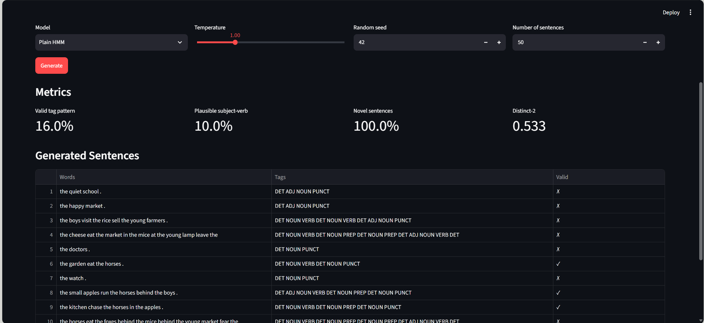
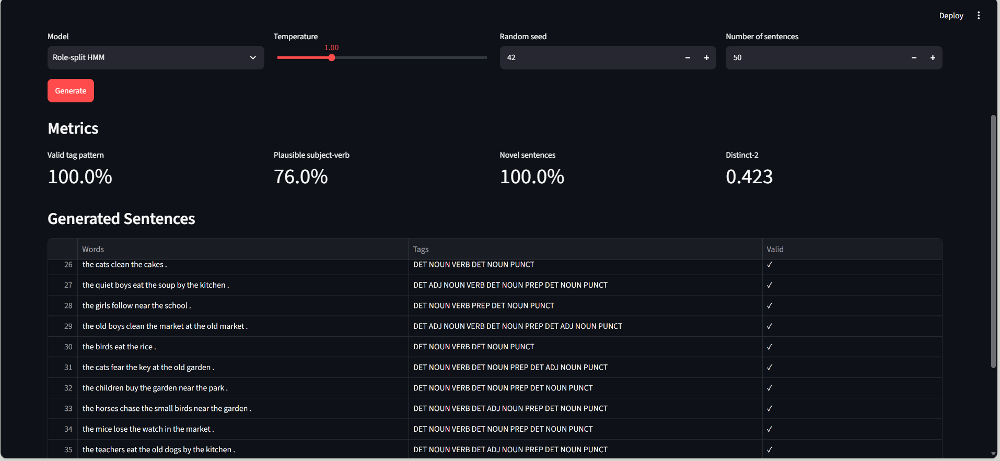
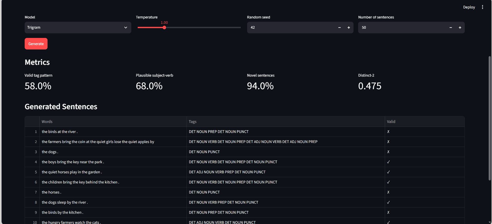

# Lab 03: Chaotic Text Generator

Hidden Markov Model (HMM) over part-of-speech tags, sampling with temperature, Viterbi decoding, role-split states, and a trigram baseline. Guide: `Lab03_Chaotic_Text_Generator_Guide.pdf` (in the parent folder).

## Files

| Path | Purpose |
|---|---|
| `src/pipeline.py` | HMM, Viterbi, temperature sampling, role-split states, trigram generator, metric functions |
| `src/evaluate.py` | Evaluation on the synthetic corpus (4 metrics, 4 temperatures, 500 sentences per setting) |
| `src/evaluate_real.py` | Part 2: the same HMM and Viterbi on real text (Universal Dependencies English EWT, downloaded on first run) |
| `app.py` | Streamlit web application with model selector, batch generation, metrics panel, and Viterbi tagger |
| `data/corpus.csv` | Synthetic tagged corpus (1,200 sentences, 6 tags). `data/make_data.py` regenerates it |
| `results/` | Outputs of the two evaluation scripts |
| `generate_report.py` | Script to generate the PDF report (requires reportlab) |

## Web Application Features

The Streamlit application (`app.py`) provides a complete test bench for text generators:

### Generator Tab
- **Model selector**: Choose between Plain HMM, Role-split HMM, or Trigram
- **Control panel**: Temperature slider (0.3-3.0), random seed, number of sentences (10-500)
- **Generate button**: Creates a batch of sentences with the selected model
- **Metrics panel**: Displays valid tag pattern, plausible subject-verb, novelty, and distinct-2 for the batch
- **Results table**: Shows each generated sentence with words, hidden tags, and validity mark (✓/✗)
- **Download CSV**: Export generated sentences to CSV file

### Tagger Tab
- **Text input**: Enter any sentence to tag with Viterbi algorithm
- **Tag display**: Shows POS tags under each word
- **OOV warning**: Highlights unknown words with visible error message
- **Robust handling**: Application does not crash on out-of-vocabulary words

### Screenshots


*Plain HMM generation with metrics panel*


*Role-split HMM with 100% valid tag pattern*


*Trigram model generation*

## Run

### Install dependencies
```bash
pip install -r requirements.txt
```

### Run evaluation scripts
```bash
python -m src.evaluate          # synthetic corpus, writes results/metrics.json and results/hmm_results.png
python -m src.evaluate_real     # real text, writes results/ewt_results.json (needs internet on first run)
```

### Run the web application
```bash
streamlit run app.py
```

The application will open in your browser at `http://localhost:8501`

### Generate the PDF report
```bash
pip install reportlab
python generate_report.py
```

Run every command from this folder.

## Testing the Application

### Test the Generator
1. Start the application: `streamlit run app.py`
2. Select a model (Plain HMM, Role-split HMM, or Trigram)
3. Adjust temperature (try 0.5 for safe output, 1.5 for creative output)
4. Set number of sentences (e.g., 50)
5. Click "Generate"
6. Review the metrics panel and results table
7. Download CSV to export results

### Test the Tagger
1. Switch to the "Tagger" tab
2. Enter a sentence from the corpus (e.g., "the cats sleep in the garden")
3. View the POS tags displayed under each word
4. Test with unknown words (e.g., "the unicorns fly in the castle") to see OOV warning
5. Verify the application handles errors gracefully

### Compare Models
1. Generate 50 sentences with each model at T=1.0
2. Compare metrics:
   - Plain HMM: ~16% valid pattern (structure issues)
   - Role-split HMM: 100% valid pattern (perfect structure)
   - Trigram: ~57% valid pattern, higher subject-verb plausibility

## Deployment note

Streamlit Community Cloud needs `requirements.txt` and `data/corpus.csv` in the repository. Do not commit `data/ewt/` (17 MB, already in `.gitignore`).

## Data

* `data/corpus.csv` is synthetic, generated by a small hand-written grammar (seed 42).
* Universal Dependencies English EWT: licence CC BY-SA 4.0, https://github.com/UniversalDependencies/UD_English-EWT

## Important Notice

The corpus is synthetic and the grammar is tiny. Metrics such as valid tag pattern are defined relative to this corpus and do not measure the quality of real English.